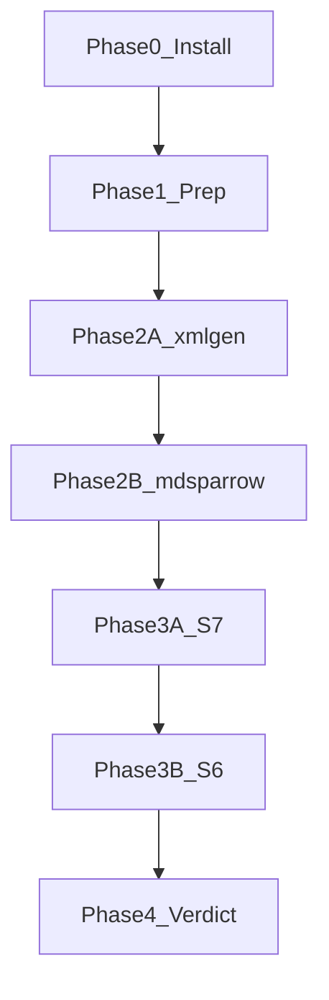

# Write-backend bake-off (урывками)

Ссылка на сценарии/скоринг: [docs/milestones/draft-write-backend-bakeoff.md](docs/milestones/draft-write-backend-bakeoff.md).

## Как продолжать после паузы

1. Открой этот plan + `docs/spikes/write-backend-bakeoff-protocol.md` (создадим в Фазе 1).
2. Напиши: «продолжаем с фазы N» или «где остановились».
3. Я смотрю чеклисты/todos и даю **один** следующий шаг (команды).
4. Ты выполняешь → кидаешь вывод / «готово» → фиксируем в protocol → следующий шаг.

Правила урывков:

- Одна сессия = минимум один закрытый **атом** (шаг 0.x, один scenario S*, или один блок docs).
- Не начинать следующую фазу, пока чеклист текущей не зелёный (или явно `skip` с причиной в protocol).
- Артефакты bake-off держим вне git-логики продукта: `~/work/my/1c-dev/.bakeoff/` (или `/tmp/1c-dev-bakeoff/`) + protocol в `docs/spikes/`.
- Env каждый раз заново (shell не помнит): см. блок «env» в protocol.



---

## Уже есть (не ставим заново)

| Компонент | Статус |
|-----------|--------|
| Платформа / ibcmd | **8.5.1.1529** |
| JDK 17 / 21 | есть; default 21 (не трогали) |
| JDK **25** Temurin | ✓ `~/.jdks/jdk-25.0.5+8`; `java -version` → 25.0.5+8-LTS |
| xml-gen jar | `~/.cache/1c-dev/tools/xml-gen.jar` |
| md-sparrow **0.6.7** | ✓ Platform Tools jar; `--help` / `-V` OK на JDK 25 |
| EDT **2026.2.2+21** | ✓ `/opt/1C/1CE/components/1c-edt-2026.2.2+21-x86_64/`; `1cedtcli --help` OK |
| EDT 2023.x / 2024.x | рядом оставить, для bake-off **не** использовать |

---

## Фаза 0 — установка

**Цель:** окружение для A, B и S6. **Done:** чеклист 0.6 зелёный.

### 0.1 JDK 25 — **DONE**

- Temurin **25.0.5+8-LTS** → `~/.jdks/jdk-25.0.5+8`
- Системный default `java` остался 21.
- Check: `"$JAVA25_HOME/bin/java" -version` → 25.0.5 (2026-11-05).
- Env: `JAVA25_HOME=/home/pila86/.jdks/jdk-25.0.5+8` / `BAKEOFF_JAVA25=$JAVA25_HOME`

### 0.2 EDT ≥2025.1 (лучше 2025.2 / 2026.1) — **DONE**

- Установлен: **2026.2.2+21** (`/opt/1C/1CE/components/1c-edt-2026.2.2+21-x86_64/`).
- Check: `1cedtcli --help` OK (2026-11-05).
- Env: `BAKEOFF_EDTCLI=/opt/1C/1CE/components/1c-edt-2026.2.2+21-x86_64/1cedtcli`
- Старые 2023.2 / 2024.x в `/opt/1C/1CE/components/` не трогать и не указывать в bake-off.

### 0.3 Smoke md-sparrow — **DONE**

- Jar: `~/.config/Code/User/globalStorage/yellow-hammer.1c-platform-tools/md-sparrow/v0.6.7/md-sparrow-0.6.7-all.jar`
- `"$JAVA25_HOME/bin/java" -jar … --help` → exit 0; `-V` → `md-sparrow 0.6.7` (2026-11-05).

### 0.4 Smoke doctor (A) — **DONE**

- `poetry run 1c-dev doctor --output json` → `status: ok`
- platform **8.5.1.1529**, ibcmd ✓, xml-gen ✓, java (product default) 21 ✓, gaps: []

### 0.5 Env (черновик до protocol в Ф1) — **DONE**

```bash
export BAKEOFF_JAVA25=/home/pila86/.jdks/jdk-25.0.5+8
export BAKEOFF_MD_SPARROW_JAR=/home/pila86/.config/Code/User/globalStorage/yellow-hammer.1c-platform-tools/md-sparrow/v0.6.7/md-sparrow-0.6.7-all.jar
export BAKEOFF_PLATFORM=8.5.1.1529
export BAKEOFF_EDTCLI=/opt/1C/1CE/components/1c-edt-2026.2.2+21-x86_64/1cedtcli
export BAKEOFF_ROOT=/home/pila86/work/my/1c-dev/.bakeoff
```

Перенести в шапку `docs/spikes/write-backend-bakeoff-protocol.md` при Фазе 1.

### 0.6 Чеклист готовности — **DONE**

- [x] JDK 25 → Temurin **25.0.5+8** (`~/.jdks/jdk-25.0.5+8`)
- [x] md-sparrow `--help` → 0.6.7 на JDK 25
- [x] doctor xml-gen + ibcmd + 8.5.1
- [x] EDT ≥2025.1 `1cedtcli` → **2026.2.2+21**
- [x] bake-off не указывает на EDT 2024.x

---

## Фаза 1 — prep / harness — **DONE** (2026-11-05)

**Цель:** воспроизводимые каталоги + журнал. **Done:** protocol создан, A и B после `init`, dump version записан.

### 1.1 Структура — **DONE**

```text
$BAKEOFF_ROOT/   # gitignored (.bakeoff/)
  A/ B/ C/ D/
docs/spikes/write-backend-bakeoff-protocol.md
```

### 1.2 Protocol — **DONE**

Файл: `docs/spikes/write-backend-bakeoff-protocol.md` (env + шаблон + summary).

### 1.3 Init — **DONE**

- A/B: `1c-dev init --type configuration --config Bakeoff{A,B} --ide-target none`
- Source: `src/BakeoffA|BakeoffB/Configuration.xml`
- Dump: **version 2.17**, `CompatibilityMode=Version8_5_1`
- `git init` + baseline commit в A и B (для S2 diff noise)

### 1.4 B: шпаргалка — **DONE**

В protocol: таблица S1–S7 + copy-paste skeleton `add-md-object` / attribute / set.

---

## Фаза 2 — XML bake-off (A vs B)

**Цель:** ответить на Decision 1 (XML write). **Done:** S1–S5 для A и B в protocol; S4 must.

Порядок атомов (можно рвать между ними):

### 2A — xml-gen (status quo)

| Атом | Что |
|------|-----|
| 2A.S1 | create `Catalog.Products` + Article String(50) — **DONE** (0.98s, OK) |
| 2A.S2 | update: реквизит, ТЧ, synonym; no-op/duplicate — **DONE** (dup=warn; ts-attr synonym→Qty) |
| 2A.S3 | delete; ChildObjects / Configuration.xml — **DONE** (0.83s; Products убран) |
| 2A.S4 | `build` + `check` — **DONE** (must OK; Wayland→нужен unset WAYLAND_DISPLAY) |
| 2A.S5 | шаги IR→tool, потери полей — **DONE** (1× `--from-json`; sugar ts-attr synonym caveat) |
| 2A.meta | wall_time / diff / ops — **DONE** (в protocol) |

Команды A: `poetry run 1c-dev metadata create|update|delete` из корня fixture.

### 2B — md-sparrow

Те же S1–S5 на `$BAKEOFF_ROOT/B` через JDK 25 + jar. S4 снова через `1c-dev build/check` (или ibcmd), не через EDT.

После 2B — **черновик XML-вердикта** в protocol (ещё не ADR):

- оставить A / мигрировать на B / нужно больше данных;
- критерии: S4, IR proximity, incremental, diff, ops (JDK 25).

**Пауза OK после:** любого S*; resume «2A.S3» / «2B.S1».

---

## Фаза 3 — EDT path (C/D)

**Цель:** Decisions 2–3. **Done:** S7 записан; S6 для C (и D если применимо); промежуточный или финальный EDT-вердикт.

### 3A — S7 (claim `.mdo` у B) — **DONE: incremental-ok**

- `init-empty-cf --format=edt` → `Configuration.mdo` + `.project`
- `apply-mutation add-md-object` на `.mdo` → `Catalogs/Products/Products.mdo`
- `apply-mutation cf-md-attribute-add` → incremental attr OK
- Прямые `cf-*` CLI на `.mdo` — fail (Designer JAXB); путь EDT = apply-mutation
- **D в игре** для S6

### 3B — S6 — **DONE** (C pass, D pass)

| Вариант | Результат |
|---------|-----------|
| **C bridge** | import ~11s → export ~13s → build/check OK; Article(50) сохранился; re-import create нужен fresh `-data` |
| **D native** | export ~16s → build/check OK; native create-in-EDT `apply-mutation` ~0.45s |

Must-fail не сработали (export непустой, ibcmd OK). EDT-лог «Premature end of file» при exit 0 — шум.

**Пауза OK после:** 3A; после C; после D; после любого подшага export/build.

Если EDT ещё не поставлен — Фазу 3 **не начинать**; можно закрыть Фазу 2 и Фазу 4 частично (только XML), EDT-вердикт = `deferred`.

---

## Фаза 4 — вердикт и docs

**Цель:** зафиксировать решение в репо. **Done:** summary + 3 Decisions + правты ADR.

### 4.1 Заполнить summary-таблицу в draft-write-backend-bakeoff

S1/S4/S5/S6, JDK/jar, вердикты XML и EDT.

### 4.2 Одна страница вердикта

В конце draft или в `docs/spikes/write-backend-bakeoff-protocol.md` (секция Verdict):

1. XML write: A или B (+ почему).
2. EDT write: C / D / отложить create на edt.
3. Второй write-backend в toolchain: да/нет/позже.

### 4.3 ADR / связанные docs

- Дополнить [ADR-007](docs/adr/007-metadata-ir.md): bake-off 2026-11, 8.5.1, md-sparrow 0.6.7, итог.
- Пометка в [draft-source-formats.md](docs/milestones/draft-source-formats.md).
- Код adapter md-sparrow — **только если** вердикт = мигрировать на B (отдельная задача, не этот bake-off).

**Пауза OK после:** 4.1 / 4.2 / 4.3.

---

## Критерии скоринга (шпаргалка)

Из draft: Correctness=must (S4); IR proximity + EDT story = high; Ops / incremental / diff / coverage / risk = med.

Must-fail: не грузится в ibcmd; битый `Configuration.xml`; пустой export exit 0.

---

## Старт

**Bake-off закрыт.** XML=A (xml-gen); EDT=D (md-sparrow `.mdo` + export); protocol + ADR-007 + drafts обновлены.
