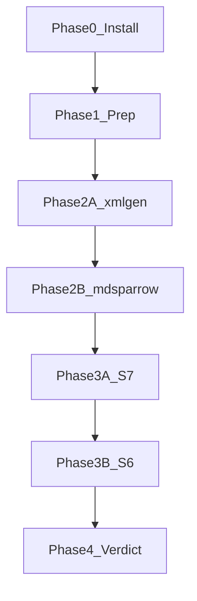

# Write-backend bake-off (урывками)

Ссылка на сценарии/скоринг: [docs/milestones/draft-write-backend-bakeoff.md](docs/milestones/draft-write-backend-bakeoff.md).

## Как продолжать после паузы

1. Открой этот plan + `docs/spikes/write-backend-bakeoff-protocol.md` (создадим в Фазе 1).
2. Напиши: «продолжаем с фазы N» или «где остановились».
3. Я смотрю чеклисты/todos и даю **один** следующий шаг (команды).
4. Ты выполняешь → кидаешь вывод / «готово» → фиксируем в protocol → следующий шаг.

Правила урывков:

- Одна сессия = минимум один закрытый **атом** (шаг 0.x, один scenario S*, или один блок docs).
- Не начинать следующую фазу, пока чеклист текущей не зелёный (или явно `skip` с причиной в protocol).
- Артефакты bake-off держим вне git-логики продукта: `~/work/my/1c-dev/.bakeoff/` (или `/tmp/1c-dev-bakeoff/`) + protocol в `docs/spikes/`.
- Env каждый раз заново (shell не помнит): см. блок «env» в protocol.



---

## Уже есть (не ставим заново)

| Компонент | Статус |
|-----------|--------|
| Платформа / ibcmd | **8.5.1.1529** |
| JDK 17 / 21 | есть; default 21 |
| xml-gen jar | `~/.cache/1c-dev/tools/xml-gen.jar` |
| md-sparrow 0.6.7 | Platform Tools jar |
| EDT 2024.x | устарел для 8.5.1 — рядом оставить, для bake-off не использовать |

---

## Фаза 0 — установка

**Цель:** окружение для A, B и S6. **Done:** чеклист 0.6 зелёный.

### 0.1 JDK 25

- Temurin/`~/.jdks`, SDKMAN или apt — на твой выбор.
- Не менять системный default `java`.
- Check: `"$JAVA25_HOME/bin/java" -version` → 25.x

### 0.2 EDT ≥2025.1 (лучше 2025.2 / 2026.1)

- С ИТС / 1CE; поддержка 8.5.1 с EDT 2025.1; платформа 8.5.1.1529 подходит.
- Check: `ls /opt/1C/1CE/components/1c-edt-202[56]*` + `$EDTCLI --help` (или аналог).

### 0.3 Smoke md-sparrow

```bash
"$JAVA25_HOME/bin/java" -jar "$BAKEOFF_MD_SPARROW_JAR" --help
```

### 0.4 Smoke doctor (A)

```bash
poetry run 1c-dev doctor --output json  # java, xml-gen, ibcmd, platform 8.5.1
```

### 0.5 Записать env в protocol (после создания файла в Ф1 можно заранее в чат)

```bash
export BAKEOFF_JAVA25=…
export BAKEOFF_MD_SPARROW_JAR=…/md-sparrow-0.6.7-all.jar
export BAKEOFF_PLATFORM=8.5.1.1529
export BAKEOFF_EDTCLI=…/1cedtcli
export BAKEOFF_ROOT=~/work/my/1c-dev/.bakeoff
```

### 0.6 Чеклист готовности

- [ ] JDK 25
- [ ] md-sparrow `--help`
- [ ] doctor xml-gen + ibcmd + 8.5.1
- [ ] EDT ≥2025.1 `1cedtcli`
- [ ] bake-off не указывает на EDT 2024.x

**Пауза OK после:** любого 0.x; resume = следующий незакрытый пункт.

---

## Фаза 1 — prep / harness

**Цель:** воспроизводимые каталоги + журнал. **Done:** protocol создан, A и B после `init`, dump version записан.

### 1.1 Структура

```text
$BAKEOFF_ROOT/
  A/          # xml-gen
  B/          # md-sparrow Designer XML
  C/          # bridge: XML→EDT (фаза 3)
  D/          # native .mdo (если S7 OK)
docs/spikes/write-backend-bakeoff-protocol.md
```

### 1.2 Protocol

Шаблон записи (из draft):

```text
variant: A|B|C|D
scenario: S1…
command(s): …
wall_time_s: …
exit_code: …
artifacts: paths
ibcmd/check: pass|fail|skip
notes: …
```

Плюс шапка: даты, версии JDK/EDT/xml-gen pin/md-sparrow/platform/dump.

### 1.3 Init

- В `A/` и `B/`: `poetry run 1c-dev init --type configuration` (или согласованный bootstrap как в M1 acceptance).
- Зафиксировать dump/format version из манифеста / `Configuration.xml`.
- `git init` в каждом fixture (для diff noise) — опционально, но удобно для S2.

### 1.4 B: шпаргалка команд

- Один раз снять `--help` / список cf-* команд в protocol.
- Мини-скрипт или copy-paste рецепт IR→S1 **без** adapter в репо.

**Пауза OK после:** 1.1, 1.2, 1.3, 1.4 по отдельности.

---

## Фаза 2 — XML bake-off (A vs B)

**Цель:** ответить на Decision 1 (XML write). **Done:** S1–S5 для A и B в protocol; S4 must.

Порядок атомов (можно рвать между ними):

### 2A — xml-gen (status quo)

| Атом | Что |
|------|-----|
| 2A.S1 | create `Catalog.Products` + Article String(50) |
| 2A.S2 | update: реквизит, ТЧ, synonym; no-op/duplicate |
| 2A.S3 | delete; ChildObjects / Configuration.xml |
| 2A.S4 | `build` + `check` — **must** |
| 2A.S5 | шаги IR→tool, потери полей |
| 2A.meta | wall_time S1, diff noise после S2, ops cost |

Команды A: `poetry run 1c-dev metadata create|update|delete` из корня fixture.

### 2B — md-sparrow

Те же S1–S5 на `$BAKEOFF_ROOT/B` через JDK 25 + jar. S4 снова через `1c-dev build/check` (или ibcmd), не через EDT.

После 2B — **черновик XML-вердикта** в protocol (ещё не ADR):

- оставить A / мигрировать на B / нужно больше данных;
- критерии: S4, IR proximity, incremental, diff, ops (JDK 25).

**Пауза OK после:** любого S*; resume «2A.S3» / «2B.S1».

---

## Фаза 3 — EDT path (C/D)

**Цель:** Decisions 2–3. **Done:** S7 записан; S6 для C (и D если применимо); промежуточный или финальный EDT-вердикт.

### 3A — S7 (claim `.mdo` у B)

- `init-empty-cf --format edt` и/или add Catalog в EDT-layout.
- Результат: `scaffold-only` | `incremental-ok` | `no-mdo` → D в игре или снят.

### 3B — S6

Общий каркас (из draft):

1. Получить EDT-проект с тем же объектом.
2. `$BAKEOFF_EDTCLI` export → XML.
3. `build` / `check` (как draft-source-formats).
4. Повторный create уже в EDT-каталоге.

Варианты:

| Вариант | Путь |
|---------|------|
| **C bridge** | write XML (A) → `1cedtcli import` (или convert) → export → build/check; отдельно create-in-EDT через повторный bridge |
| **D native** | только если 3A = incremental-ok; write `.mdo` (B) → export → build/check |

Must-fail S6: пустой export при exit 0; export не грузится в ibcmd.

**Пауза OK после:** 3A; после C; после D; после любого подшага export/build.

Если EDT ещё не поставлен — Фазу 3 **не начинать**; можно закрыть Фазу 2 и Фазу 4 частично (только XML), EDT-вердикт = `deferred`.

---

## Фаза 4 — вердикт и docs

**Цель:** зафиксировать решение в репо. **Done:** summary + 3 Decisions + правты ADR.

### 4.1 Заполнить summary-таблицу в draft-write-backend-bakeoff

S1/S4/S5/S6, JDK/jar, вердикты XML и EDT.

### 4.2 Одна страница вердикта

В конце draft или в `docs/spikes/write-backend-bakeoff-protocol.md` (секция Verdict):

1. XML write: A или B (+ почему).
2. EDT write: C / D / отложить create на edt.
3. Второй write-backend в toolchain: да/нет/позже.

### 4.3 ADR / связанные docs

- Дополнить [ADR-007](docs/adr/007-metadata-ir.md): bake-off 2026-11, 8.5.1, md-sparrow 0.6.7, итог.
- Пометка в [draft-source-formats.md](docs/milestones/draft-source-formats.md).
- Код adapter md-sparrow — **только если** вердикт = мигрировать на B (отдельная задача, не этот bake-off).

**Пауза OK после:** 4.1 / 4.2 / 4.3.

---

## Критерии скоринга (шпаргалка)

Из draft: Correctness=must (S4); IR proximity + EDT story = high; Ops / incremental / diff / coverage / risk = med.

Must-fail: не грузится в ibcmd; битый `Configuration.xml`; пустой export exit 0.

---

## Старт

При approve плана: **Фаза 0.1 JDK 25** (параллельно можно качать EDT для 0.2). Дальше — строго по чеклистам, по одному атому за сообщение, если работаешь урывками.
